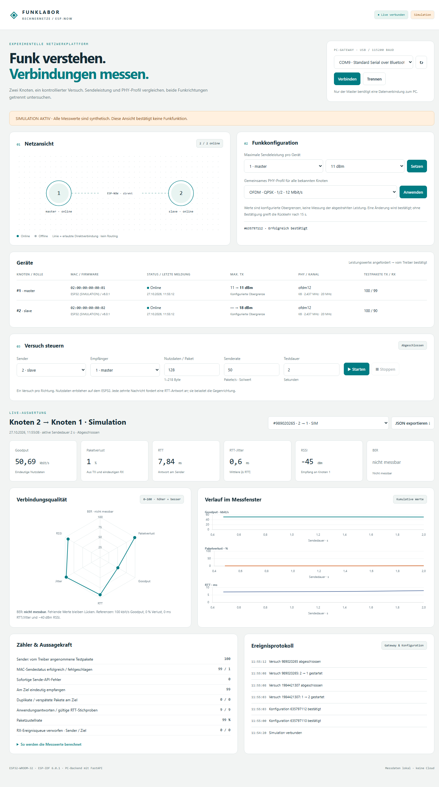

# ESP32-Rechnernetz

Ein ESP-NOW-Funklabor für ein Hochschulprojekt im Fach **Rechnernetze**. Zwei **ESP32-WROOM-32** tauschen Testdaten aus. Über eine lokale Weboberfläche lassen sich Sendeleistung und PHY-Profil einstellen und die Kommunikationsqualität beider Funkrichtungen untersuchen.

**Projektstand:** Firmware, PC-Backend und Browseroberfläche sind implementiert. Beide Firmware-Rollen wurden erfolgreich kompiliert; Softwaretests und simulierte Browserabläufe wurden geprüft. **Der reale Funkversuch mit zwei gekoppelten Boards steht noch aus.** Einzelheiten stehen im [Prüfbericht](docs/VALIDATION.md).

## Aufbau

```text
Browser
   │ HTTP / WebSocket
PC: FastAPI-Backend
   │ USB / UART
Master-ESP32  ←── ESP-NOW ──→  Slave-ESP32
```

Backend und Weboberfläche laufen auf dem PC. Im Betrieb braucht nur der Master eine Datenverbindung zum PC; der Slave benötigt eine Stromversorgung. Der erste Meilenstein verwendet genau zwei Geräte. Knotenverwaltung und Darstellung sind für eine spätere Erweiterung vorbereitet; Routing und Mehrsprungkommunikation folgen in späteren Schritten.

## Funktionen

- Grafische Netzansicht und Geräteliste mit IDs, MAC-Adressen, Rollen und Onlinezustand.
- Unabhängige maximale Sendeleistung je Gerät und gemeinsames, unterstütztes PHY-Profil.
- Bestätigte Konfigurationsänderungen mit zeitgesteuerter Rückkehr bei ausbleibender Bestätigung.
- Startbare und stoppbare Versuche in beiden Richtungen mit einstellbarer Paketgröße, Senderate und Dauer.
- Live-Auswertung von Goodput, Paketzustellung, Paketverlust, RTT, RTT-Jitter und RSSI.
- Radar-Chart, Zeitverläufe und JSON-Export der Versuche.
- Ausdrücklich gekennzeichnete Simulation für den Betrieb ohne ESP32-Hardware.

**BER wird als „nicht messbar“ angezeigt.** Die genutzte ESP-NOW-Schnittstelle liefert keine vollständige Funk-BER. Paketverlust wird separat ausgewertet. Angezeigte Sendeleistungen sind bestätigte Konfigurationsobergrenzen, keine Messung der abgestrahlten Leistung.

## Schnellstart ohne Hardware

Voraussetzungen: **Python 3.11–3.13** und Git. In PowerShell:

```powershell
git clone https://github.com/NiklasB0601736/ESP32-Rechnernetz.git
cd ESP32-Rechnernetz

python -m venv .venv
.\.venv\Scripts\python.exe -m pip install -r requirements.txt
.\.venv\Scripts\python.exe -m backend.app --demo
```

Anschließend **<http://127.0.0.1:8000>** im Browser öffnen. Der Hinweis „Simulation aktiv“ kennzeichnet synthetische Daten. Mit `Strg+C` wird das Backend beendet.

Chart.js liegt mit seiner Lizenz im Repository. Die Weboberfläche benötigt nach der Einrichtung keine Internetverbindung. Messdaten werden lokal unter `data/tests/` gespeichert.

<details>
<summary>Dashboard-Vorschau im Simulationsmodus</summary>



</details>

## Betrieb mit zwei ESP32

Benötigt werden zwei ESP32-WROOM-32, USB-Kabel bzw. Stromversorgung und **ESP-IDF 6.0.1**. Die Firmware ist auf diese Chip- und IDF-Version abgestimmt.

1. Die STA-MAC-Adresse beider Boards ermitteln.
2. Master und Slave getrennt in `menuconfig` konfigurieren. Beide verwenden denselben Kanal und die jeweilige Gegenstelle als freigegebenen Peer.
3. Beide Rollen bauen und auf das passende Board flashen.
4. Den Master mit dem PC verbinden und das Backend mit dessen seriellem Port starten.

| Einstellung | Master | Slave |
|---|---|---|
| Master-Rolle | Aktiviert | Deaktiviert |
| Knoten-ID | `1` | `2` |
| Peer-ID | `2` | `1` |
| Peer-MAC | STA-MAC des Slaves | STA-MAC des Masters |
| WLAN-Kanal | `6` | `6` |

Für den Backendstart, beispielsweise mit `COM6`:

```powershell
.\.venv\Scripts\python.exe -m backend.app --port COM6
```

Den tatsächlich verwendeten Master-Port einsetzen. Alternativ das Backend ohne `--port` starten und den Port im Browser auswählen. Die serielle Verbindung verwendet **115200 Baud, 8N1**.

**Die Standardkonfiguration enthält noch keine gültigen Peer-MACs.** Die vollständigen Befehle für `menuconfig`, Build, Flashen und den ersten Hardwaretest stehen in der [Einrichtungsanleitung](docs/SETUP.md).

## Projektstruktur

| Pfad | Inhalt |
|---|---|
| [`firmware/`](firmware/) | ESP-IDF-Firmware, Rollen und gemeinsame Konfigurationsvorlagen |
| [`backend/`](backend/) | FastAPI, serielles Gateway, Simulation und Messauswertung |
| [`frontend/`](frontend/) | Browseroberfläche und lokal eingebundene Diagrammbibliothek |
| [`tests/`](tests/) | Tests der Auswertung, Schnittstellen und Steuerung; C-Test für das Messmodul |
| [`scripts/`](scripts/) | ESP-IDF-Aufrufe, Browserprüfung und nativer Firmware-Messmodultest |
| [`docs/`](docs/) | Einrichtung, Protokolle, Messmethodik und Prüfstand |

ESP-Bibliotheken, SDK-Caches, Build-Verzeichnisse, lokale Board-Konfigurationen und Messdaten werden durch [`.gitignore`](.gitignore) ausgeschlossen. Die Firmware-Abhängigkeit cJSON wird beim ersten Build über den ESP-IDF Component Manager bezogen. Manifest und Lockdatei sind versioniert.

## Tests

```powershell
.\.venv\Scripts\python.exe -m pip install -r requirements-dev.txt
.\.venv\Scripts\python.exe -m unittest discover -s tests -v
```

Der dokumentierte Prüfstand umfasst **20 erfolgreiche Softwaretests**, erfolgreiche Builds für Master und Slave, einen PC-Lauf des tatsächlichen C-Messmoduls sowie Browserprüfungen einschließlich Mobilansicht. Für optionale Browser- und native C-Tests siehe [Einrichtungsanleitung](docs/SETUP.md#tests-und-aufbau).

## Dokumentation

- [Einrichtung, Build, Flashen und erster Hardwaretest](docs/SETUP.md)
- [Messmethodik, PHY-Profile und Diagrammnormalisierung](docs/MEASUREMENT.md)
- [Funkformat, serielles Protokoll und Backend-Schnittstellen](docs/PROTOCOLS.md)
- [Prüfergebnisse und noch offene Hardware-Abnahme](docs/VALIDATION.md)
