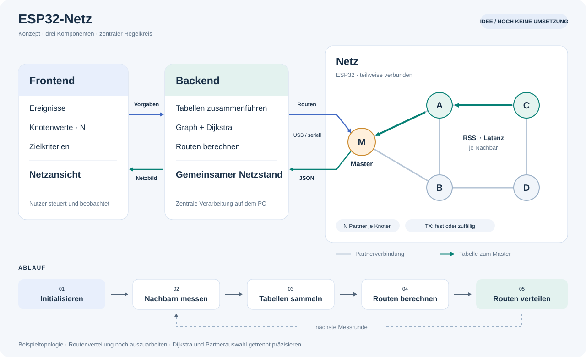

# Konzeptnotiz: zentral gesteuertes ESP32-Netz

**Stand: 10.11.2026 · Ideensammlung, keine Implementierungsspezifikation.**

Das bisherige Projekt soll perspektivisch durch den hier beschriebenen Ansatz ersetzt werden. Diese Datei hält zunächst nur die neue Idee fest. Ein Zurücksetzen, Überschreiben oder Umbauen des bestehenden Codes ist in diesem Schritt nicht vorgesehen. Die bisherigen Anleitungen beschreiben weiterhin den alten Zwei-Geräte-Aufbau.

Die Abschnitte **Vorgaben**, **eigene Interpretationen**, **Vorschläge** und **offene Punkte** sind bewusst getrennt. Interpretationen und Vorschläge sind noch keine beschlossenen Anforderungen.

## 1. Vorgaben aus der beschriebenen Idee

### Drei Komponenten

| Komponente | Aufgabe |
|---|---|
| **Frontend** | Einstellungen und Ereignisse vorgeben; das vom Backend gemeldete Netz grafisch darstellen. |
| **Backend** | Knotentabellen empfangen, zu einer gemeinsamen Struktur zusammenführen und anhand wählbarer Kriterien neue Routen bzw. Netzverbindungen berechnen. |
| **Netz** | Teilweise verbundene ESP32 mit einem Master; Nachbarn vermessen und Ergebnisse auch über mehrere Zwischenknoten zum Master weiterleiten. |

### Netz

- Das Netz besteht aus ESP32, die **nicht alle direkt miteinander verbunden** sind.
- Ein **Master** kommuniziert über die serielle Schnittstelle mit dem Backend.
- Jeder Knoten besitzt eine definierte Sendeleistung. Sie kann in der GUI festgelegt werden oder zufällig innerhalb eines vorgegebenen Bereichs schwanken.
- Jeder Knoten soll nur **N Partner** haben. Die genaue Bedeutung dieser Grenze bleibt noch festzulegen.
- Die Knoten stellen ihre vorgesehenen Nachbarschaftsbeziehungen **auf Aufforderung des Masters** her.
- Bereits bei der Initialisierung kennen sie ihre vorgesehenen Partner und einen Weg zum Master, gegebenenfalls über andere Knoten.
- In einem definierten Zeitraum prüfen alle Knoten die Verbindungsqualität zu ihren Nachbarn, soweit dies technisch möglich ist.
- Jeder Knoten erstellt eine eigene Verbindungstabelle: eine mit seiner ID „signierte“ Liste von Tupeln **(Nachbarknoten, Verbindungsstärke, Latenz)**. Bedeutung von „signiert“, Einheit und Messverfahren sind noch offen.
- Knoten ohne direkte Master-Verbindung leiten ihre Tabellen über den bekannten Weg zum Master weiter.
- Der Master reicht die einzelnen JSON-Strukturen der Ursprungsknoten an das Backend weiter.
- Das Backend übermittelt dem Master seriell eine neue Routingtabelle. Format, Verteilung und Aktivierung werden noch ausgearbeitet.

### Backend

- Empfängt die den Ursprungsknoten zugeordneten Verbindungstabellen.
- Erstellt daraus eine einheitliche Netzstruktur und übermittelt diese an das Frontend.
- Soll **Dijkstra** einsetzen, um anhand der Verbindungstabellen das gewünschte „beste Netz“ zu bestimmen. Was daran Pfadberechnung und was Auswahl der Verbindungen ist, muss präzisiert werden.
- Berücksichtigt Kriterien, die im Frontend ausgewählt bzw. verändert werden können.

### Frontend

- Erlaubt die Eingabe von Ereignissen bzw. deren Simulation.
- Ermöglicht Einstellungen einzelner Knoten, insbesondere der Sendeleistung und ihres Zufallsbereichs.
- Ermöglicht die Vorgabe der Partneranzahl N.
- Zeigt das Netz anhand der vom Backend gelieferten Verbindungsstruktur grafisch an.
- Bietet Kriterien für die Netzberechnung an: **Latenz, Verbindungsstärke, Durchsatz und BER**. Für Durchsatz und BER steht ein Mess- bzw. Bewertungskonzept noch aus.

## 2. Grafische Übersicht

Die Knotenanzahl und die gezeichneten Kanten sind nur ein Beispiel. Grün zeigt die Meldung einer Tabelle über einen Zwischenknoten zum Master. Die Grafik legt weder konkrete Partner noch eine feste Knotenzahl oder ein Funkprotokoll fest. Die Rückverteilung neuer Routen zeigt den beabsichtigten Ablauf; das zugehörige Protokoll ist noch offen.

## 3. Eigene Interpretationen und Herleitungen — noch nicht vereinbart

### Zentraler Regelkreis

**Interpretation:** Das System arbeitet in wiederkehrenden Runden:

1. **Initialisieren:** Vorgegebene Partner und erste Wege zum Master laden.
2. **Anfordern:** Master verteilt den Auftrag für eine Messrunde.
3. **Messen:** Knoten untersuchen ihre Nachbarschaft innerhalb des festgelegten Zeitraums.
4. **Melden:** Jeder Knoten sendet seine eigene Tabelle zum Master; dieser reicht sie weiter.
5. **Berechnen:** Backend aktualisiert den Graphen und berechnet anhand der GUI-Vorgaben neue Routen und gegebenenfalls Partner.
6. **Verteilen und aktivieren:** Backend sendet das Ergebnis zum Master; die betroffenen Knoten erhalten ihre Einstellungen.
7. **Wiederholen:** Nach Aktivierung folgt die nächste Messrunde.

**Herleitung:** Der bekannte Startweg löst das anfängliche Problem, dass Messberichte schon vor der ersten Optimierung zum Backend gelangen müssen. Nach einer Änderung muss dieser Steuerweg weiterhin nutzbar sein oder wiederhergestellt werden können.

### Drei unterschiedliche Arten von Beziehungen

**Interpretation:** Für ein eindeutiges Modell sind drei Ebenen nötig:

| Ebene | Bedeutung |
|---|---|
| **Hörbare bzw. messbare Nachbarn** | Knoten, von denen ein Gerät Funkpakete empfangen oder mit denen es Messungen durchführen kann. |
| **Erlaubte bzw. aktive Partner** | Die für den regulären Austausch freigegebenen Beziehungen; hier könnte die N-Grenze gelten. |
| **Routing** | Die Auswahl, über welchen aktiven Partner eine Nachricht ihr Ziel erreichen soll. |

**Herleitung:** Alle Nachbarn zu untersuchen und gleichzeitig nur N Partner zuzulassen ist nur dann eindeutig, wenn geklärt wird, ob Messkontakte ebenfalls als Partner zählen. Ein hörbarer Knoten muss nicht automatisch ein erlaubter Weiterleitungspartner sein.

### Herkunft bleibt beim Weiterleiten erhalten

**Interpretation:** Eine Tabelle von Knoten C bleibt eine Tabelle von C, auch wenn A und der Master sie weiterleiten. Ursprungsknoten und letzter Weiterleiter sind unterschiedliche Angaben. Die Zuordnung per ID ist noch keine kryptografische Signatur.

### Messrichtung und Konfiguration gehören zusammen

**Herleitung:** Eine Messung von A nach B beschreibt zunächst diese Richtung. Die Gegenrichtung wird gesondert erfasst. Außerdem muss bekannt sein, welche Sendeleistung während der Messung galt; bei zufälligen Änderungen wären Messwerte sonst schwer vergleichbar.

### Dijkstra braucht einen bereits definierten Graphen

**Technische Einordnung:** Dijkstra bestimmt Pfade mit der kleinsten Summe von Kantengewichten in einem vorhandenen Graphen. Für den vorgesehenen Ansatz müssen daraus nichtnegative Kosten entstehen. Negative RSSI-Werte dürfen nicht unverändert als Dijkstra-Kosten verwendet werden. Die [NetworkX-Dokumentation zu Dijkstra](https://networkx.org/documentation/stable/reference/algorithms/generated/networkx.algorithms.shortest_paths.weighted.single_source_dijkstra.html) beschreibt die Pfadberechnung und ihre Gewichtung.

**Herleitung:** Die zusätzliche Aufgabe, aktive Partner unter einer N-Grenze auszuwählen und dabei die Erreichbarkeit des Masters zu erhalten, ist damit noch nicht definiert. „Bestes Netz“ braucht daher eine eigene Zielfunktion und eine Regel zur Auswahl der Kanten.

## 4. Vorschläge für die noch offenen Konzepte — nicht beschlossen

### A. Zunächst eine klare Grundvariante festlegen

**Vorschlag:** N zunächst als **maximale Zahl aktiver direkter Partner pro Knoten** behandeln. Ob der Master dieselbe Grenze hat, ausdrücklich festlegen. Weniger Partner sind zulässig, wenn die physische Nachbarschaft nichts anderes ermöglicht. Eine neue Konfiguration wird nur übernommen, wenn die geforderten Wege zum Master bestehen.

**Vorschlag:** Für den ersten Entwurf zunächst bekannte, erlaubte Verbindungen vermessen und darauf Routen berechnen. Eine zusätzliche Suche nach alternativen Partnern kann als eigener Schritt folgen. So bleiben Routing und Topologieauswahl unterscheidbar.

### B. Messrunden koordinieren

**Vorschlag:** Der Master vergibt eine Messrunden-ID, Messdauer und aufeinanderfolgende Sendezeiten. Alle Knoten arbeiten innerhalb derselben Runde, senden aber nicht gleichzeitig sämtliche Prüfpakete. Dadurch lassen sich gegenseitige Belastung und fehlende Antworten besser einordnen.

**Vorschlag:** Beim Messen die Sendeleistung kurz konstant halten. Zufällige Leistungsänderungen zwischen den Runden ausführen und zu jeder Runde speichern: Bereich, gewählter Konfigurationswert, Änderungsintervall und Zufalls-Seed. Nur von der Hardware unterstützte Stufen verwenden. Ein Zufallswert ist eine Leistungsänderung; er erzeugt kein zusätzliches Störsignal. Die [Espressif-API zur Sendeleistung](https://docs.espressif.com/projects/esp-idf/en/v6.0.1/esp32/api-reference/network/esp_wifi.html#_CPPv425esp_wifi_set_max_tx_power6int8_t) beschreibt die Konfiguration des bisherigen Hardwareansatzes.

### C. Begriffe und Messwerte präzisieren

| Größe | Vorschlag |
|---|---|
| **Verbindungsstärke** | RSSI empfangener Prüfpakete in **dBm**; dB für Differenzen bzw. Verhältnisse. Mittelwert und Stichprobenzahl je Richtung speichern. |
| **Latenz** | Zunächst RTT einer Anfrage mit Antwort messen. Eine echte Einweglatenz erfordert ein zusätzliches Zeit-/Synchronisationskonzept. RTT/2 nicht als gemessene Einweglatenz ausgeben. |
| **Zustellung** | Sendungen, eindeutige Ziel-Empfänge und Antworten getrennt zählen; fehlende Rückantwort nicht automatisch als Verlust des Hinwegs behandeln. |
| **Durchsatz** | Zunächst gerichteten Goodput messen: eindeutig empfangene Nutzdatenbits pro Messdauer. Messungen einzelner Verbindungen und des gesamten Mehrsprungpfads getrennt betrachten. |
| **BER** | Bis zu einem belastbaren Messkonzept als **nicht verfügbar** führen; nicht aus Paketverlust schätzen. Eine Bitfehlersimulation gegebenenfalls als gesonderte Simulation kennzeichnen. |

Falls ESP-NOW beibehalten wird, bestätigt dessen MAC-Sendestatus keinen sicheren Empfang in der Zielanwendung. Die Empfangsschnittstelle stellt auch keinen vollständigen Strom beschädigter Funkbits zur BER-Auswertung bereit. Daraus folgt für diesen Ansatz: Eine echte Funk-BER ist über diesen Empfangspfad nicht belastbar ableitbar. Grundlage: [ESP-NOW-Sende- und Empfangsschnittstellen](https://docs.espressif.com/projects/esp-idf/en/v6.0.1/esp32/api-reference/network/esp_now.html).

### D. Routingkosten und Topologieauswahl getrennt entwickeln

**Vorschlag für die erste Routingversion:** Latenz als einziges Pfadkriterium verwenden. Eine Mindest-RSSI-Bedingung kann unbrauchbare Kanten ausschließen. Anschließend Dijkstra auf dem zulässigen Graphen ausführen.

**Späterer Vorschlag:** Mehrere Kriterien zunächst auf vergleichbare, nichtnegative Kosten abbilden. Die GUI legt fest, ob ein Kriterium optimiert, nur als Mindestanforderung geprüft oder mit anderen gewichtet wird. Referenzwerte und Gewichte müssen sichtbar sein; fehlende Messwerte dürfen keine besonders guten Kosten erhalten.

**Offene Herleitung:** Der Engpass-Goodput eines Pfads ist keine Summe der Link-Goodputs. Auch „stärkster Pfad“ braucht eine Definition, etwa die Qualität der schwächsten Verbindung. Eine gewichtete Kostensumme wäre ein gewähltes Bewertungsmodell und kein Beweis für das global beste Netz. Dies gilt besonders bei zusätzlicher N-Grenze und gemeinsam genutztem Funkkanal.

**Vorschlag für die Graphenrichtung:** Für Knoten → Master und Master → Knoten getrennte Pfade berücksichtigen. Bei gerichteten Kanten kann die Sammlung von Wegen zum Master über eine Pfadberechnung vom Master im umgedrehten Graphen erfolgen. Der Rückweg folgt daraus nicht automatisch.

### E. Herkunft und Weiterleitung dokumentieren

**Vorschlag für einen späteren Bericht:** Mindestens `source_id`, `report_id`, `measurement_round`, Messzeitraum, Konfigurationsversion und Nachbarliste vorsehen. Je Nachbar Messrichtung, RSSI, RTT bzw. eindeutig benannte Latenzgröße, Stichprobenzahl und Erreichbarkeit angeben. Nicht erhobene Werte bleiben `null`; eine leere Liste ist von einem fehlenden Bericht zu unterscheiden.

**Vorschlag für Weiterleitung:** Ursprung und Inhalt erhalten; Weiterleitungsinformationen getrennt führen. Paket-ID, Duplikaterkennung und eine maximale Hopanzahl vorsehen. Bei Bedarf Nachrichten in kleinere Funkpakete zerlegen. Ob die ursprünglichen JSON-Strukturen bereits über Funk oder erst an der seriellen Schnittstelle erzeugt werden, bleibt eine Designentscheidung.

**Falls Authentizität verlangt wird:** Die ursprüngliche Meldung zusätzlich authentifizieren oder digital signieren. Die genaue Bedeutung von „signiert“ und die Schlüsselverwaltung müssen dann gesondert festgelegt werden.

### F. Neue Routen kontrolliert aktivieren

**Vorschlag:** Jede Routingkonfiguration erhält eine Version. Der Master verteilt sie zunächst über die bisher funktionierenden Wege. Die Knoten bestätigen den Empfang; danach folgt eine definierte Aktivierung. Bei Nichterreichbarkeit greift eine festgelegte Rückkehr zur letzten brauchbaren Konfiguration.

**Vorschlag:** Verbindungswerte über mehrere Runden glätten und eine Mindestverbesserung vor einem Wechsel verlangen. Dadurch kann verhindert werden, dass kleine Schwankungen ständig neue Routen auslösen. Fehlende bzw. zu alte Berichte erhalten einen eigenen Zustand; sie werden nicht als Messwert null interpretiert.

### G. Hardware- und Simulationsereignisse unterscheiden

**Vorschlag:** Die GUI benennt, ob ein Ereignis eine reale Änderung auslöst oder nur im Modell wirkt. Beispiele: unterstützte Sendeleistungsstufe setzen, Weiterleitung anhalten, eine Verbindung logisch sperren oder Paketverlust simulieren. Künstliche Verluste und künstliche Bitfehler bleiben im Ergebnis erkennbar.

## 5. Lücken und Unschlüssigkeiten, die vor der Umsetzung zu klären sind

| Punkt | Warum er noch offen ist |
|---|---|
| **„Nur N Partner“** | Genau N oder höchstens N? Globaler Wert oder je Knoten? Zählen eingehende und ausgehende Kontakte gemeinsam? Gilt die Grenze auch für den Master? |
| **Erreichbarkeit bei kleinem N** | Manche Grenzen erlauben keine zusammenhängende Topologie. Bei gegenseitigen Verbindungen und maximal einem Partner pro Knoten lässt sich beispielsweise kein zusammenhängendes Netz mit mehr als zwei Knoten aufbauen. |
| **Alle Nachbarn messen, nur N Partner nutzen** | Es fehlt die Regel, ob Messkontakte außerhalb der aktiven Partner erlaubt sind und ob bislang unbekannte Nachbarn überhaupt entdeckt werden sollen. |
| **Starttopologie und Master-Auftrag** | Sind die Partner am Start nur bekannt oder schon kommunikationsbereit? Wie erreicht der erste Master-Auftrag indirekte Knoten, bevor reguläre Verbindungen aktiviert sind? |
| **Routenänderung und N-Grenze** | Während eines Wechsels können alte und neue Partner zusammen mehr als N ergeben. Es fehlt die Entscheidung zwischen vorübergehender Ausnahme und einem Wechsel, der die Grenze durchgehend einhält. |
| **Vorgegebene Partner oder Optimierung** | Darf das Backend Partner austauschen oder nur Wege über fest erlaubte Partner wählen? Bei ausschließlich festen Partnern kann es keine beliebige neue Netzstruktur erzeugen. |
| **„Bestes Netz“ und Dijkstra** | Offen sind Ziel, Kostenmodell und Nebenbedingungen: kürzeste Pfade, geringe Maximallatenz, hohe Erreichbarkeit, faire Lastverteilung oder etwas anderes. |
| **Rückweg vom Master** | Ein funktionierender Berichtsweg zum Master garantiert keine erfolgreiche Verteilung von Befehlen in Gegenrichtung. Beide Richtungen müssen berücksichtigt werden. |
| **Verbindungsstärke „in dB“** | RSSI, Dämpfung und ein selbst definierter Qualitätswert sind verschiedene Größen. Bezeichnung, Einheit und Messrichtung fehlen. |
| **„Mit ID signiert“** | Eine Herkunftsangabe und eine kryptografische Signatur erfüllen unterschiedliche Aufgaben. Die gewünschte Bedeutung ist noch nicht festgelegt. |
| **Latenz** | Einweglatenz, RTT, Warteschlangenzeit oder Latenz eines gesamten Pfads? Paketgröße und Auswertung müssen vergleichbar sein. |
| **Zufällige Leistung** | Bereich, unterstützte Stufen, Verteilung, zeitlicher Verlauf und Verhalten während einer Messrunde fehlen. Außerdem ist offen, ob der Master ebenfalls schwanken darf. |
| **Durchsatz und BER** | Messverfahren und Pfadbewertung fehlen. Für BER ist insbesondere die Verfügbarkeit realer fehlerhafter Funkbits ungeklärt. |
| **Ausfall und veraltete Tabellen** | Wiederholungen, Fristen, Teilberichte, Neustarts, Netztrennung und Rückkehr zum Ausgangszustand brauchen Regeln. |
| **Routingtabellen verteilen** | Unklar sind Format, Zustellweg, Bestätigungen und das Verhalten bei teilweise empfangenen bzw. aktivierten Versionen. |
| **Funkprotokoll und „Scan“** | Die neue Idee legt das Funkverfahren noch nicht fest. Ein WLAN-AP-Scan und die Suche nach anwendungseigenen ESP32-Nachbarn sind unterschiedliche Vorgänge. |

**Einordnung für einen möglichen ESP-NOW-Ansatz:** ESP-NOW arbeitet verbindungslos; „verbinden“ müsste hier als Verwaltung zugelassener Partner und Nachrichtenwege definiert werden. Eine logische Partnersperre begrenzt nicht die physische Hörbarkeit des Funks. Für Nachbarerkennung kämen eigene Kennungs- und Prüfmeldungen infrage. Der normale Wi-Fi-Scan sucht Access Points. Siehe [ESP-NOW-Grundprinzip und Peerverwaltung](https://docs.espressif.com/projects/esp-idf/en/v6.0.1/esp32/api-reference/network/esp_now.html) sowie [Wi-Fi-Scan-API](https://docs.espressif.com/projects/esp-idf/en/v6.0.1/esp32/api-reference/network/esp_wifi.html#_CPPv418esp_wifi_scan_startPK18wifi_scan_config_tb).

Für die nächste Konzeptentscheidung sind vor allem **Bedeutung von N**, **Messkontakte gegenüber aktiven Partnern**, **Zielfunktion der Optimierung** und **sichere Verteilung neuer Routen** ausschlaggebend. Erst danach lässt sich der Umfang einer Neuimplementierung eindeutig festlegen.
